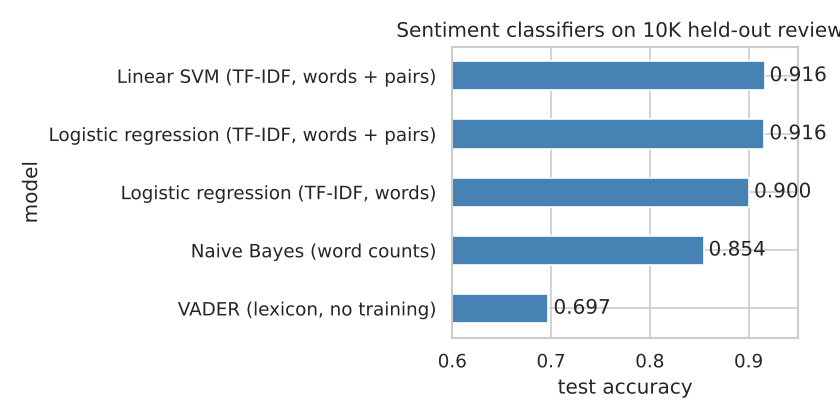
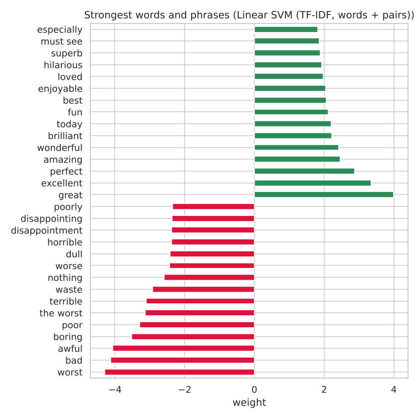

# Movie Review Sentiment Classification

Classifies 50,000 IMDB reviews as positive or negative. Compares a rule-based lexicon with trained models, explains what the best model learned, and analyzes where it fails.



## Data

[IMDB Large Movie Review Dataset](https://ai.stanford.edu/~amaas/data/sentiment/) (Maas et al., 2011) as a single CSV: 50,000 reviews, half positive and half negative. After removing 418 duplicate reviews, 80% is used for training and 20% (9,917 reviews) for testing. The notebook downloads the data on first run.

## Approach

- Text cleaning (HTML line breaks, whitespace)
- **VADER**: rule-based sentiment lexicon, no training
- **Naive Bayes** on word counts
- **Logistic regression** and **linear SVM** on TF-IDF features, single words and word pairs
- Feature weights to see what the model learned
- Error analysis: confident mistakes, review length, and mixed-opinion reviews

## Results

| Model | Accuracy | F1 |
|---|---:|---:|
| VADER (no training) | 0.697 | 0.740 |
| Naive Bayes (word counts) | 0.854 | 0.851 |
| Logistic regression (TF-IDF words) | 0.901 | 0.902 |
| Logistic regression (TF-IDF words + pairs) | 0.916 | 0.917 |
| **Linear SVM (TF-IDF words + pairs)** | **0.916** | **0.917** |



**Findings**

- Training on labeled reviews beats the general-purpose lexicon by 22 points.
- Word pairs add 1.6 points over single words ("the worst", "must see").
- Errors are more common in mixed reviews: 9.2% of reviews with "but" or "however" are misclassified, against 5.9% of the rest.
- Some of the most confident "mistakes" are reviews whose label looks wrong, so the dataset has some label noise.

## How to run

```bash
git clone https://github.com/mehtesham13/imdb-sentiment-analysis.git
cd imdb-sentiment-analysis
pip install -r requirements.txt
jupyter notebook sentiment_analysis.ipynb
```

## Next steps

Fine-tune a transformer (DistilBERT) and measure whether reading word order and context is worth the extra compute.

Author: Muhammad Ehtesham · [LinkedIn](https://www.linkedin.com/in/muhammad-ehtesham-dsa)
